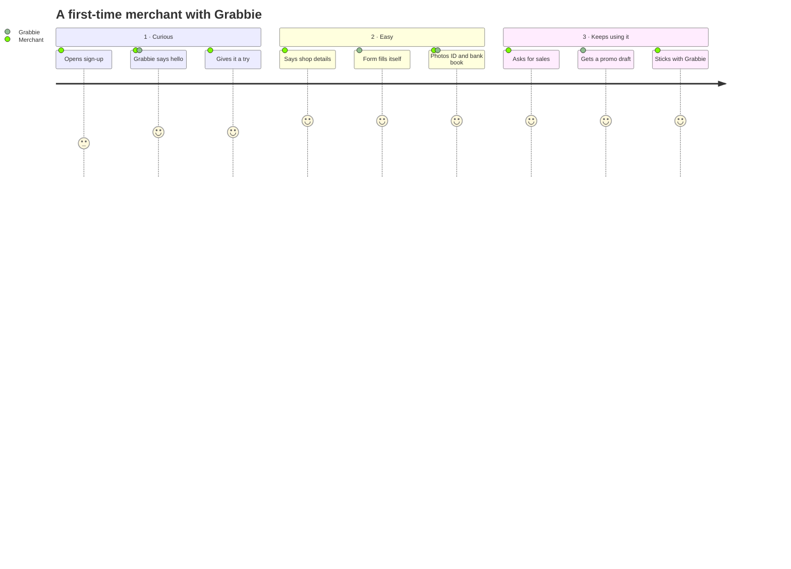
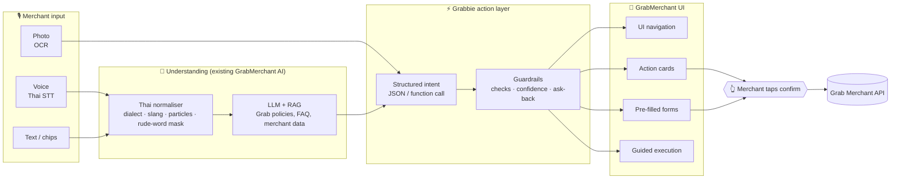
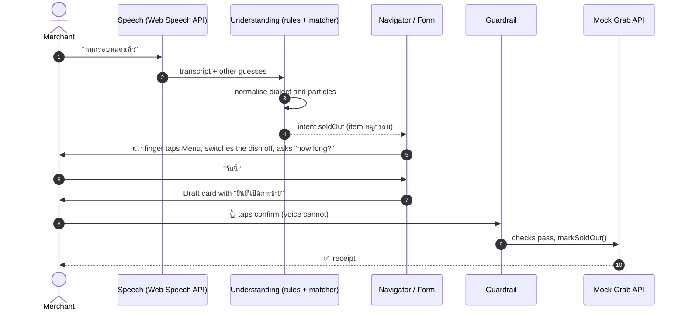

<div align="center">


# Grabbie – Actionable AI Co-Pilot for GrabMerchant

**From Complexity to Empowerment:** taking GrabMerchant AI from a passive assistant to an AI co-pilot that acts, without reinventing the wheel.

[](https://github.com/66011601/GrabSpark-Champion-Repo/actions/workflows/deploy-pages.yml)
[](#-team)
[](https://66011601.github.io/GrabSpark-Champion-Repo/)
<br />
[](https://react.dev)
[](https://www.typescriptlang.org)
[](https://vite.dev)
[](https://tailwindcss.com)
[](https://vitest.dev)
[](https://cloud.google.com/text-to-speech)

**[▶ Try the live prototype](https://66011601.github.io/GrabSpark-Champion-Repo/)** · Built by team **PITIPIWPIW WIW WIW** for the **GrabSpark Hackathon**

</div>

---

## 📑 Table of Contents

- [Overview](#-overview)
- [The Problem vs. Our Solution](#-the-problem-vs-our-solution)
- [Key Features](#-key-features)
- [The Merchant's Emotional Journey](#-the-merchants-emotional-journey)
- [System Architecture](#%EF%B8%8F-system-architecture)
- [Tech Stack](#%EF%B8%8F-tech-stack)
- [Getting Started](#-getting-started)
- [Project Structure](#-project-structure)
- [Presenting the Demo](#-presenting-the-demo)
- [The Companion's Voice](#-the-companions-voice)
- [Team](#-team)
- [Credits & Licences](#-credits--licences)

---

## 🌱 Overview

**Grabbie** (น้องแกร็บบี้) is a voice-first AI co-pilot that sits inside the GrabMerchant app. She helps Thailand's **MSME merchants, street-food vendors and local shop owners**, many of whom are not comfortable with technology, sign up and run their store by **talking**, **taking a photo**, or **tapping a suggestion** instead of filling in long forms.

Text-only chatbots tell a merchant *what to do*. Grabbie *does it with them*. She turns what the merchant means into structured actions on the real GrabMerchant screens:

| Action type | What the merchant sees |
|---|---|
| 🧭 **UI navigation** | A finger walks through the app and taps to the right page ("ขอดูยอดขายหน่อย" → Insights → Sales → 7 days) |
| 📝 **Pre-filled forms** | Shop name, address, map pin, food type, owner and bank details filled in from speech or a photo, each marked "heard" until the merchant checks it |
| 🃏 **Action cards** | A ready-to-confirm draft (a rainy-day promotion, a sold-out dish, new menu items) with the AI's reasoning and safety checks |
| 🤝 **Guided execution** | Step-by-step help that asks back when unsure. **She never presses confirm or send for the merchant.** |

> **Human in the loop by design:** the AI only prepares drafts. Every action that changes the shop (submit, confirm, publish) is a tap only the merchant can make. Saying "ยืนยัน" gets a polite "only you can press this button".

---

## 🧩 The Problem vs. Our Solution

<table>
<tr>
<th width="50%">😣 The problem</th>
<th width="50%">💡 Our solution: an AI that acts</th>
</tr>
<tr>
<td valign="top">

- **Onboarding and KYC are long forms.** 7 steps, dozens of fields, ID card and bank-book numbers typed on a small screen.
- **Merchants speak differently.** Isan, Northern and Southern dialects, street-food slang, and particles (ครับ / ค่ะ / น้า / ว่ะ) confuse rigid inputs.
- **Today's AI assistants are passive.** A text-only LLM answers in paragraphs; the merchant still has to find the screen and do it alone.
- **Powerful features go unused.** Insights, forecasts and promotions sit behind menus that non-tech-savvy owners never open.

</td>
<td valign="top">

- **Talk or take a photo instead of typing.** Grabbie fills the form and flags anything she is unsure of in amber.
- **Thai-localised understanding.** Dialect words become central Thai, slang and particles are handled, rude words are masked, and unclear requests get an ask-back ("หมายถึง…ใช่ไหมคะ?").
- **An action layer, not a chat window.** What the merchant means becomes a structured action: navigate, pre-fill, draft a card, or guide.
- **Reuse, don't rebuild.** The design plugs into GrabMerchant's existing AI and RAG stack instead of training a new LLM.

</td>
</tr>
</table>

---

## ✨ Key Features

### 👧 A friendly "helpful niece" persona
Grabbie talks like a patient niece who is good with phones. She calls herself **หนู** and ends her sentences with **ค่ะ**. She introduces herself on the very first screen, explains what she can do, and guides the merchant one step at a time through onboarding and KYC. She has 6 animated poses (wave, cheer, heart, wink, hands on hips, delivery bag) that match what she is saying, and she replies warmly when the merchant says thank you.

### ⚙️ An action layer architecture
Voice, text and photo (OCR) input all go through one understanding pipeline. It produces a **structured intent**, the same shape an LLM function call would return, and that intent drives the UI:

- **Act 1, sign-up (7 steps):** one sentence such as *"ร้านชื่อครัวป้าแดงค่ะ ขายน้ำพริกปลาทู อยู่ลาดพร้าวซอยเจ็ดสิบเอ็ด ตรงข้ามเซเว่น"* fills the shop name, street, map pin, address and food type. A photo of an ID card or bank book fills that whole step.
- **Act 2, running the shop:** a voice navigator opens any of the 13 home items, presses any button from any screen, and runs five guided scenarios: sales, a rain forecast, a rainy-day promotion, a dish that has sold out, and customer feedback.

### 🗣️ Thai-localised language understanding
- **Regional dialects:** Isan, Northern (คำเมือง) and Southern words map to central Thai (`ข้อยขายส้มตำเด้อ`, `เบิ่งยอดขายแหน่`).
- **Particles and slang:** polite endings, dialect closers and interjections (ครับ / ค่ะ / คับ / จ้า / เด้อ / เจ้า / ว่ะ) are stripped before matching. Rude words are masked as `***` and never reach a field.
- **Ambiguous requests:** a matcher trained on **~4,000 sentences** acts when it is sure, asks back when it is unsure, and offers buttons when it is lost. On held-out sentences it gets **85–87% right in every region**, and acts wrongly without asking **≤ 0.1%** of the time.
- **Thai–English code-switching:** short English replies such as *ok*, *yes*, *next*, *back*, *menu* and *stop* are understood mid-conversation.
- **Speech-recogniser repair:** common Thai mis-hearings are fixed before matching. For example, บาด becomes บาท after a price, and Northern เจ้า is restored at the end of a sentence.

### 💸 Cost-efficient infrastructure
- **No new foundation model.** The production design reuses GrabMerchant's existing AI and RAG services. Grabbie adds the action layer on top.
- **The prototype costs nothing to run.** Understanding runs in the browser, and the companion's voice is recorded once and served as static MP3s (about 630 lines, 13 MB).
- **Safe by construction.** Every AI-prepared draft passes guardrail checks (`src/ai/guardrail/`) before the merchant's tap can send it to the (mock) Grab API.

---

## 💚 The Merchant's Emotional Journey



| Stage | Merchant feels | Where it happens in the prototype |
|---|---|---|
| **1 · Curious, gives it a try** | *"Oh, there's an AI assistant here? Let me give it a try!"* | The **first registration screen**: Grabbie greets the merchant, introduces herself, and lists what she can do (tap and speak, fill forms, go to any page, read a photo). |
| **2 · Easy & convenient** | *"Wow, it literally does everything for me! All I have to do is just answer."* | **Sign-up steps 3–7**: one sentence fills a page, photos fill KYC, missing or unsure fields are flagged, and the summary is read aloud before the merchant taps to submit. |
| **3 · Keeps using it** | *"That was so quick and easy! I'm definitely sticking with Grabbie as my store co-pilot."* | **Act 2, 30 days later**: the voice navigator finds sales, forecasts, promotions, sold-out dishes and reviews, so the merchant starts using features they never knew about. |

---

## 🏗️ System Architecture

### Target architecture (production)



### What this prototype runs

The hackathon build runs **entirely in the browser with no LLM call**, so the demo works the same every time, works offline, and is free to host. Each production layer has a stand-in that keeps the same contract (natural language in, structured intent out), so the LLM can be swapped in later without changing the UI:

| Production layer | Prototype stand-in | Code |
|---|---|---|
| Thai speech-to-text | Browser Web Speech API (`th-TH`), plus a mis-hearing repair pass | `src/services/speech/speechToText.ts`, `src/ai/language/heard.ts` |
| Thai normaliser | Dialect dictionary, particle and slang stripping, rude-word masking | `src/ai/language/` |
| LLM intent + slot extraction | Rule-based parsers for each screen, plus a **TF-IDF nearest-neighbour matcher** trained on ~4,000 Thai sentences, with sure / unsure / lost levels | `src/ai/onboarding/`, `src/ai/understanding/` |
| RAG answers (FAQ) | Fixed answers chosen by the matcher (fees, approval time, payouts, documents, data safety, riders) | `src/ai/understanding/bank/faq.ts` |
| Function calls → UI | Navigator scripts, button map and drafts, played by a runner that moves the finger | `src/ai/navigator/` |
| Guardrails | Draft checks plus the confirm-only-by-tap rule | `src/ai/guardrail/` |
| OCR | Mock OCR that "reads" the sample ID card, bank book or menu | `src/services/ocr/mockOcr.ts` |
| Grab Merchant API | Mock read/write API with sample merchant data | `src/services/merchantApi*.ts`, `src/data/` |
| Companion voice | Pre-recorded Google Cloud TTS (Chirp 3 HD), falling back to the device's Thai voice | `src/services/speech/textToSpeech.ts`, `scripts/voice/` |



---

## 🛠️ Tech Stack

| Layer | Technology |
|---|---|
| **Frontend / mobile mock-up** | [React 19](https://react.dev), [TypeScript 6](https://www.typescriptlang.org), [Vite 8](https://vite.dev), [Tailwind CSS 4](https://tailwindcss.com), [lucide-react](https://lucide.dev) icons. The app renders inside a phone frame with a Demo panel beside it. |
| **Understanding (LLM stand-in)** | Rule-based Thai parsers, a dialect dictionary and a TF-IDF / cosine nearest-neighbour matcher calibrated on held-out sentences (`src/ai/understanding/matcher.ts`) |
| **LLM + RAG (production target)** | GrabMerchant's existing AI and RAG services, called through the same structured-intent contract |
| **Speech in** | Web Speech API, `th-TH`, with up to 3 guesses per turn. A turn ends after 1.5 s of silence. |
| **Speech out** | Google Cloud Text-to-Speech, Chirp 3 HD *Leda*, pre-recorded to MP3 and played faster and higher. The device's `speechSynthesis` is the fallback. |
| **OCR** | Mock OCR returning sample ID card, bank book and menu reads, with confidence scores |
| **Maps & places** | [Leaflet](https://leafletjs.com), OpenStreetMap tiles and Nominatim, Google Maps / LINE link parsing, and an offline Thai sub-district and postcode database |
| **Companion art** | Layered 2.5D avatar and 6 full-body poses (WebP), cut by `scripts/companion-layers/` and `scripts/companion-poses/` |
| **Quality** | [Vitest](https://vitest.dev) (1,400+ unit, corpus and architecture tests), [oxlint](https://oxc.rs) with zero warnings, `tsc -b` strict build |
| **CI/CD** | GitHub Actions: test → build → deploy to GitHub Pages on every push to `main` |

---

## 🚀 Getting Started

### Prerequisites
- **Node.js 22+** and npm
- **Chrome or Edge** (desktop or Android) for Thai speech recognition

### Run the prototype

```bash
git clone https://github.com/66011601/GrabSpark-Champion-Repo.git
cd GrabSpark-Champion-Repo
npm install
npm run dev        # http://localhost:5173
```

Open it in a desktop browser. The phone frame is on the left and the **Demo panel** is on the right (press `D` to hide or show it). Tap **รับทราบ เริ่มเลย** to start. That tap also lets the browser play Grabbie's voice.

### Scripts

| Command | What it does |
|---|---|
| `npm run dev` | Starts the dev server with hot reload |
| `npm test` | Runs every unit, language-corpus and architecture test |
| `npm run lint` | Runs oxlint |
| `npm run build` | Type-checks (`tsc -b`) and builds to `dist/` |
| `npm run preview` | Serves the production build locally |
| `npm run voice` | Records any new companion lines with Google Cloud TTS (see [below](#-the-companions-voice)) |

> 💡 No API key is needed to run the demo. The recorded voice is already in `public/voice/`, and every document and number in the app is a fictional sample marked **ตัวอย่าง**.

---

## 📂 Project Structure

```text
src/
├── ai/
│   ├── commands/        # spoken button words ("ต่อไป", "ถ่ายรูป", "ยืนยัน"…)
│   ├── language/        # Thai normaliser: dialects, particles, rude words, mis-hearing repair, test corpus
│   ├── understanding/   # TF-IDF matcher + ~4,000-sentence bank, ask-back, FAQ
│   ├── onboarding/      # sign-up: slot extraction from speech, documents, follow-up questions
│   ├── navigator/       # Act 2: intents → scripts, buttons, pages, drafts
│   └── guardrail/       # draft checks; confirm only by the merchant's tap
├── components/          # companion (avatar, poses, spotlight), Grab UI kit, map, scan, shell
├── screens/
│   ├── signup/          # G0 welcome → S1–S7 sign-up (GrabMerchant's real 7 steps)
│   ├── home/            # menu and opening hours after sign-up
│   └── act2-grow/       # the GrabMerchant dashboard, driven by voice
├── services/            # speech in/out, mock OCR, places, mock Grab API, OTP
├── copy/th.ts           # every line the companion says or shows
└── data/                # sample merchant, OCR samples, Thai address data
scripts/
├── voice/               # records the companion's lines (npm run voice)
├── companion-layers/    # cuts the 2.5D avatar layers
└── companion-poses/     # cuts the full-body poses
docs/
├── specs/               # design specs
├── plans/               # implementation plans
└── PRESENTING.md        # step-by-step stage guide
```

---

## 🎬 Presenting the Demo

The full stage guide is in **[docs/PRESENTING.md](docs/PRESENTING.md)**. The short version:

1. **Act 1, sign-up.** Grabbie introduces herself, then: **ลงทะเบียน** → GrabFood → account → phone OTP (auto-filled) → **3/7**: tap 🎤 and say the shop in one sentence → **5/7, 6/7**: 📷 photograph the ID card and bank book → **7/7**: hear the summary, tick and send *yourself*.
2. **Home.** Add menu items from a paper-menu photo or by voice, then set opening hours by voice.
3. **Act 2, 30 days later.** Try *"ขอดูยอดขายหน่อย"*, *"พรุ่งนี้ฝนตก ออเดอร์จะเป็นไง"*, *"ทำโปรวันฝนตกให้หน่อย"*, *"หมูกรอบหมดแล้ว"*, *"ลูกค้าบ่นอะไรบ้าง"*, or the name of any button.
4. **The trust moment.** Say *"ยืนยัน"* on the promotion. Grabbie explains that only the merchant can press it.

Design specs: [merchant companion](docs/specs/2026-10-13-merchant-companion-design.md) · [Grab-style sign-up](docs/specs/2026-10-14-grab-style-signup-design.md) · [location input](docs/specs/2026-10-14-location-input-design.md) · [Thai language](docs/specs/2026-10-14-thai-language-design.md) · [Act 2 voice navigator](docs/specs/2026-10-15-act2-voice-navigator-design.md) · [understanding](docs/specs/2026-10-15-understanding-design.md)

---

## 🔊 The Companion's Voice

Grabbie speaks with recorded lines (Google Cloud Text-to-Speech, Thai voice Leda, played a little faster and higher so she sounds like a little girl) from `public/voice/`, so she sounds the same on every device. A line with no recording, such as a dish name the merchant made up, is read by the device's own Thai voice. On the dev server, any such line is logged in the console as `[voice] not recorded`.

After changing what she says, record the new lines (only lines without a recording are sent):

```bash
npm run voice
```

- **Key:** the script reads `GOOGLE_TTS_API_KEY` from the environment or from `.env.local`. That file is git-ignored; never commit the key.
- **Restricted key:** if the key only works from the site's address, set `TTS_REFERER` to that address.
- **Which lines:** every sentence in `src/copy/th.ts`, the lines built from the demo's data (`scripts/voice/demoLines.ts`: Act 2 scripts, pages, buttons, dishes, ask-backs, scan results), and `scripts/voice/spoken.json`. To collect more, run the demo on the dev server, then copy `JSON.stringify([...window.__spokenLines], null, 1)` from the browser console into that file.
- **Gemini voice:** `TTS_VOICE=gemini npm run voice` uses Gemini 3.1 Flash TTS with the style "Cute, Friendly, Little Girl". It needs the Vertex AI API turned on in the Google Cloud project.

---

## 👥 Team

<div align="center">

### 🏆 PITIPIWPIW WIW WIW

Built for the **GrabSpark Hackathon**

*Grabbie: helping every Thai merchant go from "I'm not good with apps" to "my co-pilot handles it."*

</div>

---

## 📜 Credits & Licences

- **Prototype notice:** this is a demo for the GrabSpark Business Case presentation, not a real-world launch. All merchants, documents and figures are fictional samples.
- **Maps and place search:** © [OpenStreetMap](https://www.openstreetmap.org/copyright) contributors (ODbL), via Nominatim, within its [usage policy](https://operations.osmfoundation.org/policies/nominatim/).
  - Places a merchant searches, pins or locates are sent to Nominatim to find the address. The prototype's own documents and applications are not sent anywhere.
  - Nominatim allows 1 request per second, and the hosted demo shares that limit. When it is busy, the app falls back to its own sample places and sub-district data.
- **Thai sub-district and postcode data:** [thai-address-database](https://github.com/Sellsuki/thai-address-database) 0.0.33 (ISC), copied as `src/data/thai-address.json`. Its licence notice is in `src/data/thai-address.LICENSE.md`.
- **Map view:** [Leaflet](https://leafletjs.com) (BSD-2-Clause).
- **Voice:** Google Cloud Text-to-Speech.
